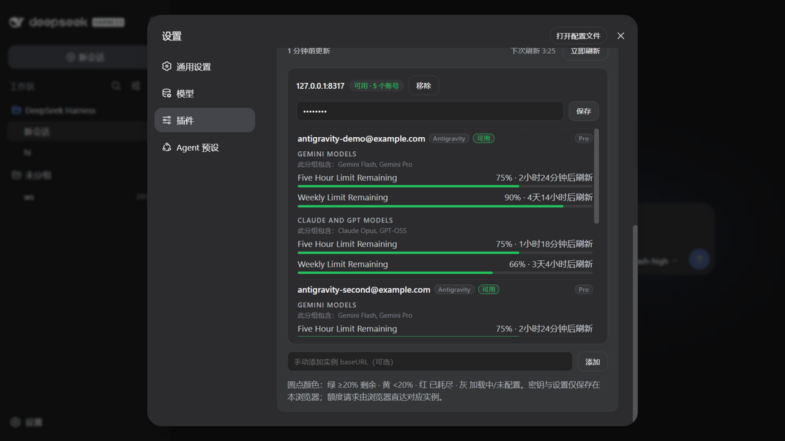
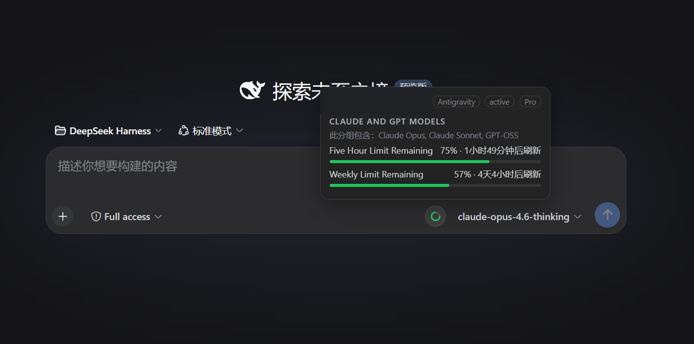

# dsh-model-quota

给 [DeepSeek Harness](https://github.com/deepseek-ai/deepseek-harness) 用的**模型额度面板**：左侧栏常驻一个入口，点开就是一张表——**每个账号 × 每个厂商**的订阅套餐、额度窗口和重置倒计时，不用再进「设置 → 插件」翻卡片。

## 功能

- **侧栏入口**：与「插件」「自动化任务」同级，点一下切到额度页（原生 `layout.selectPanel`，会高亮当前面板）
- **额度页**：按账号分组，显示厂商徽章、订阅套餐（Pro 等）、全部额度窗口（5 小时 / 每周 / 每月）与「多久后刷新」
- **输入框圆环**：模型名左侧一个小圆点，悬停即可看当前模型对应账号的额度
- **自动发现实例**：读取 DSH 各 provider 的 `baseURL` 判断是否为 CliProxyAPI，不需要手工维护模型列表
- **多实例 / 多账号**：支持同时看多个网关和多个登录账号
- **颜色语义**：绿 ≥20% 剩余、黄 <20%、红 已耗尽、灰 加载中/未配置
- **零依赖**：纯 JavaScript，无构建步骤；管理密钥只存在当前浏览器的 `localStorage`

## 截图

额度页内容（各账号 × 各厂商的额度窗口）：



输入框模型名旁的圆环与悬浮卡：



## 安装

```powershell
git clone https://github.com/isayrhythm/dsh-plugins.git
cd "$env:USERPROFILE\.dsh\profiles\desktop"
pnpm add "<clone 路径>\plugins\model-quota"
```

把 `"dsh-model-quota"` 加进该 profile `package.json` 的 `dsh.profile.bundles`，然后重启 DSH。

## 配置

1. 打开 DSH 设置 → 插件 → **CliProxyAPI 额度**
2. 填入 CLIProxyAPI 的**管理密钥**（`config.yaml` 里的 `management.secret-key`），保存
3. 实例会按 provider 的 `baseURL` 自动发现；也可以手动添加

> 管理接口需要在网关侧开启（`management.allow-remote: true`，若前面有反向代理，记得把 `/v0/management/` 也转发过去）。

## 许可

MIT。初始版本参考并衍生自 `dsh-client-ui-cpa-quota`（MIT），MIT 版权声明见 [LICENSE](LICENSE)；此后本插件已独立演进。
